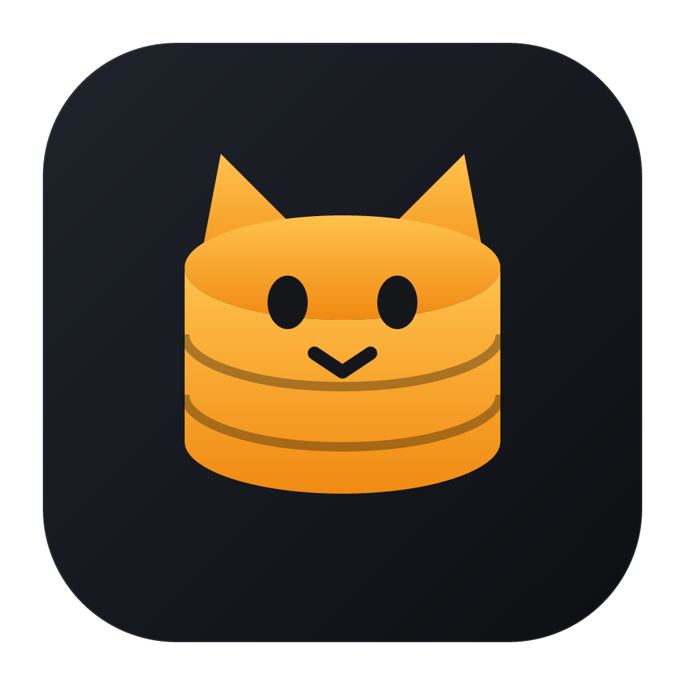

<p align="center"></p>

# DevCat

An all-in-one, cross-platform developer workbench: AI coding agents in a real terminal, Git, databases,
Kubernetes, RabbitMQ and VPN / SSH tunnels in one app. Built with [Tauri 2](https://tauri.app) (Rust)
and React + TypeScript; runs on macOS, Windows and Linux.

| Area | Supported |
| --- | --- |
| AI | AI Workspace (terminal, diff, code review) running your installed coding agent: Claude Code (default), OpenAI Codex, Gemini CLI, GitHub Copilot, Aider, opencode or a custom CLI |
| Git | Nested repo discovery, commit graph, blame, branches, tags, stashes, fetch/pull/push |
| SQL databases | PostgreSQL, MySQL / MariaDB, SQLite, SQL Server |
| NoSQL | MongoDB, Redis |
| Infrastructure | Kubernetes (any kubeconfig context), RabbitMQ (management API) |
| Networking | OpenVPN, WireGuard, SSH tunnels (local forwards + SOCKS proxy) |

## Download

Grab the latest installer for macOS, Windows or Linux from the
[Releases page](https://github.com/devileya/DevCat/releases/latest).

## Features

- **Projects**: group connections into projects and focus on one project at a time.
- **Automatic updates**: DevCat checks GitHub releases and offers new versions in a popup (Update and restart / Later /
  Skip this version), or use *Check for updates…* in the project menu or click the version in the status bar. Updates are
  signed and verified before installing. Linux .deb/.rpm installs get a download link instead (the AppImage self-updates).
- **Keep awake**: the coffee cup at the top right keeps the screen and computer from sleeping (like Caffeine /
  Amphetamine). Click to toggle; right-click to keep awake for 15 minutes to 8 hours.
- **Multiple windows**: ⇧⌘N (Ctrl+Shift+N) opens another window; open a project in its own window or move a tab
  to a new window. Each window has its own tabs and project focus.
- **Connections**: saved profiles with color tags, SSH tunnels, SSL, read-only mode.
  Passwords are stored in the OS keychain (macOS Keychain / Windows Credential Manager),
  never in plain files.
- **Object browser**: databases, schemas, tables, views, functions, procedures, triggers,
  sequences, indexes, collections, Redis keys.
- **SQL editor**: Monaco with schema-aware autocomplete, run statement or selection, multiple result sets,
  explain, formatting, cancel, query history and saved queries.
- **Data grid**: virtualized, inline editing with commit/discard, filters, sorting, paging,
  copy as CSV/TSV/JSON/INSERT, form view.
- **Table designer**: columns, indexes, foreign keys, with generated CREATE/ALTER SQL preview.
- **ER diagram**: auto-layout, relationship highlighting, export to image.
- **Schema compare and sync**, **data compare**.
- **Data transfer**: export (CSV, JSON, SQL, Excel), import (CSV/JSON with column mapping),
  SQL backup and restore, and copying tables between connections, even across dialects.
- **MongoDB**: document/table/JSON views, editing, aggregation pipeline builder, shell-style queries.
- **Redis**: key browser, editors for every data type, TTL, CLI console.
- **Kubernetes**: cluster overview, applications, workloads, config, network, storage, events, Helm releases and
  CRDs with live updates; per-row actions (logs, shell, port-forward, scale, restart, edit YAML, delete),
  including logs and shell on Deployments with a pod switcher.
- **RabbitMQ**: overview with live message-rate charts; queues, exchanges, bindings, connections,
  channels and consumers; publish and get messages; declare, purge and delete.
  Paste an `amqp://` URL to fill the connection form.
- **VPN & SSH tunnels**: import `.ovpn` / WireGuard `.conf` files or `~/.ssh/config` hosts, or set them up
  in a form; connect/disconnect with live status, logs and a realtime traffic graph. Connections can depend
  on a VPN or tunnel, which is connected automatically first. VPNs need administrator rights to connect
  (the OS asks for your password); OpenVPN / `wireguard-tools` must be installed.
  - **Passwordless VPN** (macOS / Linux, opt-in): *Set up passwordless VPN…* in the VPN list installs a
    root-owned copy of DevCat as a helper (`/Library/PrivilegedHelperTools/dev.devcat.vpn-helper` on macOS,
    `/usr/local/libexec/devcat-vpn-helper` on Linux) plus a sudoers rule for your account only
    (`/etc/sudoers.d/dev-devcat-vpn`), with one password prompt. After that, connects use `sudo -n` without a
    password. The helper refuses configs that run scripts or load plugins (OpenVPN `up`/`down`/`plugin`…,
    WireGuard `PostUp`/`PreDown`…) and files that aren't yours, and it only runs OpenVPN / wg-quick from
    root-owned, non-writable locations (a Homebrew install under `/opt/homebrew` doesn't qualify). Those cases
    fall back to the password prompt. *Remove* deletes both files. Windows keeps using UAC.
- **AI Workspace**: runs your installed coding-agent CLI in a real terminal (like iTerm2), with
  **Chat ⌥⇧⌘1 · Diff ⌥⇧⌘2**, a git-aware file tree and file previews (code, Markdown, PDF, images,
  Excel/CSV, Word). The agent is an *AI connection* picked in the sidebar header: [Claude Code](https://docs.claude.com/en/docs/claude-code)
  by default, or OpenAI Codex, Gemini CLI, GitHub Copilot CLI, Aider, opencode or any custom command
  (args + env vars). Each uses its own login, or an optional API key kept in the OS keychain and passed as
  the provider's env var (e.g. `OPENAI_API_KEY`). With Claude Code you also get **Code Review ⌥⇧⌘3**,
  launch options and your Claude session list (resume any session); other agents get a Review button that
  asks them in the terminal.

- **Git**: scan a folder for every repository inside it (nested repos, submodules and worktrees; `node_modules`
  and build folders are skipped) and see branch, ahead/behind and changes at a glance. Each repo opens a Git tab
  with a commit graph (all branches, search, author and file-history filters) and per-commit diffs, working-tree
  changes with stage/commit/stash (tick files to commit or discard just those, or discard all), branches/tags/remotes, and stashes. Checkout, branch, merge, tag, cherry-pick,
  revert and reset from the history. **Blame** for any file preview, with an age heatmap and a link to each commit.
  Fetch, pull and push use your SSH agent or credential helper (they never prompt).

## Development

Prerequisites: Node 20+, pnpm, Rust (stable), plus the
[Tauri prerequisites](https://tauri.app/start/prerequisites/) for your OS
(Xcode Command Line Tools on macOS; Microsoft C++ Build Tools + WebView2 on Windows).

```bash
pnpm install
pnpm tauri dev          # run the app with hot reload
```

UI testing in a normal browser (dev only): the Git and file commands are served over HTTP by a
debug-only bridge, and the other Tauri APIs are stubbed.

```bash
cd src-tauri && cargo run --example devbridge   # http://127.0.0.1:1430
pnpm dev:bridge                                 # http://localhost:1425
```

Local test services for every supported backend:

```bash
docker compose -f docker-compose.dev.yml up -d
```

| Service | Address | Credentials |
| --- | --- | --- |
| PostgreSQL | localhost:55432 | postgres / devcat |
| MySQL | localhost:53306 | root / devcat |
| SQL Server | localhost:51433 | sa / DevCat_Passw0rd! |
| MongoDB | localhost:57017 | devcat / devcat |
| Redis | localhost:56379 | none |
| RabbitMQ | localhost:55673 (management) | devcat / devcat |

Backend integration tests (need the services above):

```bash
cd src-tauri && cargo test -- --ignored
```

## Building installers

```bash
pnpm tauri build        # builds for the current OS
```

- **macOS** → `src-tauri/target/release/bundle/dmg/DevCat_<version>_aarch64.dmg` (and `.app`)
- **Windows** → `src-tauri/target/release/bundle/msi/*.msi` and `nsis/*-setup.exe`

Release builds also produce signed update bundles, so they need the updater signing key
(`TAURI_SIGNING_PRIVATE_KEY` and `TAURI_SIGNING_PRIVATE_KEY_PASSWORD`; CI reads them from repository secrets). Without it,
build with `pnpm tauri build --config '{"bundle":{"createUpdaterArtifacts":false}}'`.

Each OS's installers must be built on that OS. CI does all of them: push a tag (`git tag v0.1.0 && git push --tags`)
or run the **build** workflow manually. `.github/workflows/build.yml` builds macOS (Apple Silicon and Intel),
Windows (`.exe`/`.msi`) and Linux (`.AppImage`/`.deb`/`.rpm`) installers and publishes them on the GitHub release.

macOS builds are ad-hoc signed but not notarized, so allow DevCat once via *System Settings → Privacy & Security →
Open Anyway* (or run `xattr -dr com.apple.quarantine /Applications/DevCat.app`). If macOS says the app "is damaged"
(builds before v0.2.1), run `codesign --force --deep --sign - /Applications/DevCat.app` and the `xattr` command above. For distribution, configure code signing and
notarization ([macOS](https://tauri.app/distribute/sign/macos/), [Windows](https://tauri.app/distribute/sign/windows/)).

## Project layout

```
src/                      React frontend
  lib/                    API wrappers + shared types (mirror the Rust types)
  store/                  zustand stores (connections, tabs, ui)
  tabs/                   tab kinds + registry
  features/               connections, query, grid, table, history, redis, mongo,
                          er, compare, transfer, k8s, rabbitmq, network, claude, files, git
src-tauri/src/
  db/                     Driver trait + postgres, mysql, sqlite, mssql, mongo, redis,
                          ssh tunnels, cross-dialect DDL, transfer/backup
  infra/                  kubernetes, rabbitmq
  network/                VPN (OpenVPN, WireGuard), SSH tunnels, traffic counters
  gitx/                   git tools: repo discovery, log/graph, blame, branches, stashes, remotes
  claude/                 AI workspace: Claude Code CLI driver, PTY terminal, sessions, file previews, git
  ai/                     AI connections (agent CLI profiles, detection, keychain API keys)
  commands/               Tauri command handlers
  store.rs                saved connections (JSON) + OS keychain secrets
```
